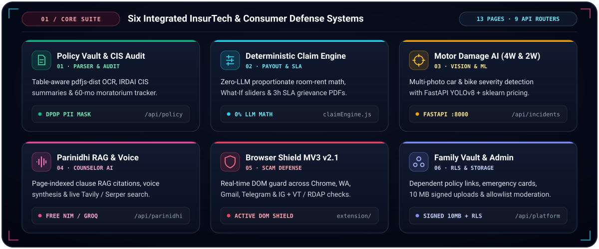
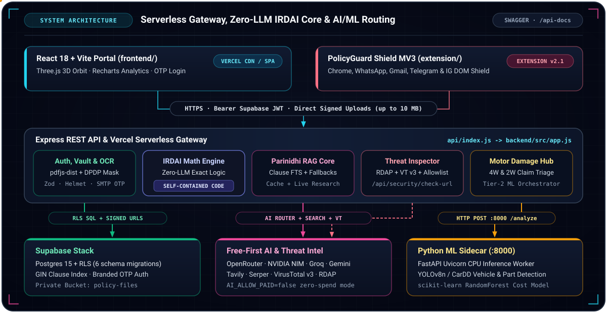
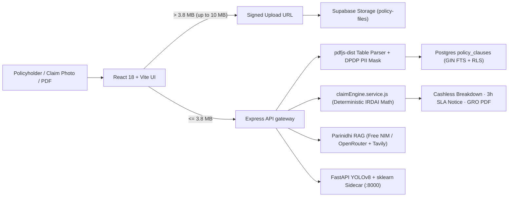
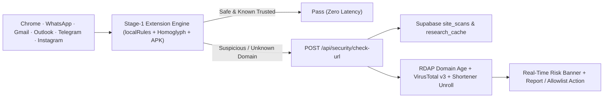

<div align="center">

<a href="https://policyguard-ai-ecru.vercel.app">
  
</a>

<br />

<h3>Insurance Protection, IRDAI 2024 Claims Intelligence, Motor Vision Estimator &amp; Browser Scam Shield</h3>

<p>
  <a href="https://policyguard-ai-ecru.vercel.app"></a>
  <a href="https://react.dev/"></a>
  <a href="https://nodejs.org/"></a>
  <a href="https://supabase.com/"></a>
  <a href="https://fastapi.tiangolo.com/"></a>
  <a href="extension/manifest.json"></a>
  <a href="LICENSE"></a>
</p>

<p>
  <a href="https://policyguard-ai-ecru.vercel.app"><strong>Launch Live App</strong></a>
  &nbsp;&middot;&nbsp;
  <a href="#-platform-showcase"><strong>Capabilities</strong></a>
  &nbsp;&middot;&nbsp;
  <a href="#-system-architecture"><strong>Architecture</strong></a>
  &nbsp;&middot;&nbsp;
  <a href="#-browser-shield-extension-v21"><strong>Browser Shield</strong></a>
  &nbsp;&middot;&nbsp;
  <a href="#-quick-start--deployment"><strong>Quick Start</strong></a>
  &nbsp;&middot;&nbsp;
  <a href="#-api-surface"><strong>API Surface</strong></a>
</p>

</div>

---

**PolicyGuard AI** is a full-stack InsurTech and consumer protection platform combining **table-aware PDF policy parsing**, **deterministic IRDAI 2024 compliance arithmetic**, **interactive claim payout simulation**, **Parinidhi AI policy-grounded counseling**, a **FastAPI + YOLOv8 motor damage sidecar**, and a **Chrome Manifest V3 Browser Shield extension** guarding Chrome tabs, WhatsApp Web, Gmail, Outlook Web, Telegram Web, and Instagram.

---

## ✨ Platform Showcase

<p align="center">
  
</p>

### Core Subsystems

| Module | What It Does | Key Files |
| :--- | :--- | :--- |
| **Policy Vault & CIS Audit** | Parses policy PDFs & E-Cards with table-aware `pdfjs-dist` OCR, generates IRDAI Customer Information Sheets (CIS), tracks 60-month moratorium timelines, diffs renewal policies year-over-year, and runs agent mis-selling audits. | [`policy.routes.js`](backend/src/routes/policy.routes.js), [`PolicyPage.jsx`](frontend/src/pages/PolicyPage.jsx) |
| **Deterministic Claim Engine** | Executes **zero-LLM arithmetic** for proportionate room-rent deductions, consumables, co-pays, interactive What-If sliders, 7-scenario payout estimators, 3-hour Cashless Discharge SLA notices, and GRO appeal PDFs. | [`claimEngine.service.js`](backend/src/services/claimEngine.service.js), [`ClaimsPage.jsx`](frontend/src/pages/ClaimsPage.jsx) |
| **Motor Damage AI (4W & 2W)** | Hybrid car and two-wheeler multi-photo severity analyzer pairing cloud vision fallbacks with a local FastAPI CPU YOLOv8 + `scikit-learn` RandomForest cost calibrator mapped to statutory depreciation rules. | [`ml-service/main.py`](ml-service/main.py), [`incidents.routes.js`](backend/src/routes/incidents.routes.js) |
| **Parinidhi AI & Live Research** | Clause-cited policy RAG chat (`policy_clauses` GIN FTS), multilingual voice guidance, global policy Q&A, and live web verification via Tavily & Serper with cached benchmark insights. | [`parinidhi.service.js`](backend/src/services/parinidhi.service.js), [`GlobalChatPage.jsx`](frontend/src/pages/GlobalChatPage.jsx) |
| **Browser Shield MV3 v2.1** | Two-stage real-time protection across Chrome tabs, WhatsApp Web, Gmail, Outlook, Telegram Web, and Instagram against fake renewal scams, `.apk`/double-extension drops, homoglyphs, and reverse-UPI traps. | [`extension/manifest.json`](extension/manifest.json), [`BrowserShieldPage.jsx`](frontend/src/pages/BrowserShieldPage.jsx) |
| **Family Vault, Signed Uploads & Admin** | Links family dependents to active policies, generates emergency card PDFs, routes `>3.8 MB` uploads via direct 10 MB Supabase signed URLs, and moderates verified insurer domains. | [`platform.routes.js`](backend/src/routes/platform.routes.js), [`FamilyVaultPage.jsx`](frontend/src/pages/FamilyVaultPage.jsx), [`AdminPage.jsx`](frontend/src/pages/AdminPage.jsx) |

---

## 🏗 System Architecture

<p align="center">
  
</p>

### Data & Verification Flows

<details open>
<summary><strong>Interactive Mermaid Pipelines: Claim &amp; Policy Flow + Browser Shield 2-Stage Defense</strong></summary>





</details>

---

## 🛡 Browser Shield Extension (v2.1)

PolicyGuard Shield runs directly inside the browser (`extension/`) and stays synced with your web portal via `site-bridge.js`, with a pre-built bundle hosted at [`frontend/public/policyguard-extension.zip`](frontend/public/policyguard-extension.zip):

- **Multi-Surface Coverage**: Dedicated DOM scanners for **WhatsApp Web**, **Gmail & Outlook Web**, **Telegram Web**, **Instagram**, and general **HTTP/HTTPS Chrome tabs**.
- **Stage-1 Offline Defense**: Detects punycode/homoglyph insurer impersonation (`hdfc-ergo` lookalikes), suspicious `.apk` / double-extension download links, fake claim-refund hooks, and reverse-UPI payment traps before clicking.
- **Stage-2 Cloud Threat Intelligence**: Cross-checks unknown URLs against [`/api/security/check-url`](backend/src/routes/platform.routes.js) using VirusTotal, RDAP domain registration age, verified insurer allowlists (`verified_domains`), and Supabase TTL caching.

---

## 🔐 Security, Privacy & Zero-Cost Guardrails

- **Zero-LLM Financial Math**: Coverage scores, 60-month moratorium eligibility, room-rent deductions, motor depreciation, and appeal calculations run strictly in deterministic code ([`claimEngine.service.js`](backend/src/services/claimEngine.service.js)).
- **Postgres RLS & Ownership Scoping**: Database schema and 6 incremental migrations in [`supabase/migrations/`](supabase/migrations) enforce Row-Level Security, and backend queries scope records strictly by authenticated `req.user.id`.
- **Upload & Passwordless Auth Hardening**: Binary magic-byte inspection validates `PDF`, `JPG`, `PNG`, and `WEBP` uploads; Branded SMTP 6-digit OTP verification and passwordless flows sync cleanly with Supabase Auth.
- **Cost-Safe Free-First AI Routing**: `AI_ALLOW_PAID=false` restricts inference to free tiers (OpenRouter `:free` / NVIDIA NIM / Groq / Gemini fallback chain) unless paid routing is explicitly enabled.

---

## 🧰 Tech Stack

| Layer | Technologies |
| :--- | :--- |
| **Frontend SPA** | React 18, Vite 5, React Three Fiber (`@react-three/fiber`, `three`), Framer Motion, Recharts, Lucide Icons, Tailwind-style design system |
| **Backend API** | Node.js, Express 4, Zod validation, `pdfjs-dist`, `pdf-lib`, `nodemailer` (SMTP OTP), `helmet`, `winston`, Swagger (`swagger-jsdoc`), Jest + Supertest (`49` unit tests across `5` suites) |
| **Database & Storage** | Supabase PostgreSQL + GIN Full-Text Search, Row-Level Security (RLS), Supabase Auth, Private Storage Bucket (`policy-files`) |
| **ML Sidecar** | Python, FastAPI, Uvicorn, CPU YOLOv8 (`yolov8n.pt` / `cardd_yolov8.pt`), `scikit-learn` RandomForestRegressor |
| **AI & External Intel** | OpenRouter / NVIDIA NIM / Groq / Gemini, Tavily & Serper Live Search, VirusTotal v3, RDAP WHOIS |
| **Browser Extension** | Chrome Extension Manifest V3 (v2.1), `site-bridge.js`, Stage-1 Local Rules Engine |

---

## 🚀 Quick Start & Deployment

### 1. Local Full-Stack Setup

<details>
<summary><strong>Step-by-step commands for Backend API, Python ML Sidecar, Frontend SPA &amp; Chrome Extension</strong></summary>

**Prerequisites:** Node.js `22+` (recommended for Supabase Realtime/Auth compatibility), Python `3.10+` (optional for `ml-service/`), and a Supabase project with migrations from [`supabase/migrations/`](supabase/migrations) applied.

```bash
# 1. Backend API (http://localhost:5000 + Swagger /api-docs)
cd backend
cp .env.example .env
npm ci
npm run lint
npm test
npm run dev
```

```bash
# 2. Frontend SPA (http://localhost:5173)
cd frontend
cp .env.example .env
npm ci --legacy-peer-deps
npm run dev
```

```bash
# 3. Optional Motor Vision ML Sidecar (http://127.0.0.1:8000)
cd ml-service
python -m venv .venv
.venv\Scripts\activate      # Windows (source .venv/bin/activate on Linux/macOS)
pip install -r requirements.txt
uvicorn main:app --host 127.0.0.1 --port 8000
```

```bash
# 4. Chrome Extension (Developer Mode)
# Open chrome://extensions -> Enable Developer Mode -> Load unpacked: ./extension
```

</details>

### 2. Docker & Cloud Deployment

- **Docker Compose**: Run `docker compose up -d --build` (configured in [`docker-compose.yml`](docker-compose.yml)).
- **Vercel + Supabase**: [`vercel.json`](vercel.json) routes `/api/*` and `/api-docs*` to [`api/index.js`](api/index.js) and serves the static bundle from `frontend/dist`. See [`docs/deployment.md`](docs/deployment.md) and [`DEPLOY.md`](DEPLOY.md) for all environment variables and checklists.

---

## 📡 API Surface

<details>
<summary><strong>Core Express Route Groups (Swagger UI available at <code>/api-docs</code>)</strong></summary>

| Prefix | Router | Auth | Summary |
| :--- | :--- | :--- | :--- |
| `/api/health` | [`app.js`](backend/src/app.js) | Public | System uptime, Supabase DB latency, active AI provider metadata |
| `/api/auth` | [`auth.routes.js`](backend/src/routes/auth.routes.js) | Mixed | Registration, branded SMTP OTP codes (`send-otp`, `verify-otp`), session refresh, profile |
| `/api/policy` | [`policy.routes.js`](backend/src/routes/policy.routes.js) | Bearer | Policy PDF/E-Card upload, CIS summary, 60-month moratorium, renewal diff, mis-selling audit, emergency card PDF |
| `/api/claims` | [`claims.routes.js`](backend/src/routes/claims.routes.js) | Bearer | Claim records & interactive claim evaluation guidance |
| `/api/incidents`, `/api/damage`, `/api/settlements` | [`incidents.routes.js`](backend/src/routes/incidents.routes.js) | Bearer | 7-scenario multi-evidence estimator, What-If simulator, 3h SLA notice, motor damage AI, settlement decoder & GRO PDF |
| `/api/documents` | [`document.routes.js`](backend/src/routes/document.routes.js) | Bearer | General document PDF analyzer & Q&A |
| `/api/chat` | [`chat.routes.js`](backend/src/routes/chat.routes.js) | Bearer | Policy chat sessions & history |
| `/api/parinidhi`, `/api/family`, `/api/research`, `/api/storage` | [`platform.routes.js`](backend/src/routes/platform.routes.js) | Bearer | Parinidhi counselor, Family Vault links, live search benchmarks, 10 MB signed upload URLs |
| `/api/security` | [`platform.routes.js`](backend/src/routes/platform.routes.js) | Mixed | URL scam checks, batch scanning, verified insurer domains, scam reporting, extension ZIP download |
| `/api/market` | [`market.routes.js`](backend/src/routes/market.routes.js) | Bearer / Admin | Insurer benchmarks & cached market research insights |
| `/api/admin` | [`admin.routes.js`](backend/src/routes/admin.routes.js) | Admin | Platform telemetry, user directory, scam moderation queue, verified domain CRUD |

</details>

---

## 📁 Repository Structure

```text
policy-ai/
├── api/                    # Vercel serverless entrypoint (api/index.js)
├── backend/                # Express API, Zod validation, pdfjs-dist OCR, IRDAI math engine & Jest suite
│   ├── src/                # Controllers, routes, services, middleware & config
│   └── tests/              # 5 Jest test suites (claimEngine, security, mappersAndParser, aiGuard, routesValidation)
├── frontend/               # React 18 + Vite + Three.js 3D landing, Recharts analytics & 13 SPA pages
│   └── public/             # Static assets & packaged policyguard-extension.zip
├── extension/              # Chrome MV3 Browser Shield v2.1 (WhatsApp, Gmail, Outlook, Telegram, IG & Web)
├── ml-service/             # Python FastAPI + CPU YOLOv8 + scikit-learn motor estimator sidecar
├── supabase/               # Config & 6 PostgreSQL migrations (schema, RLS, grants, FTS & 2W benchmarks)
├── docs/                   # Architecture, deployment & scaling guides + SVG visual assets (docs/assets/)
├── k8s/                    # Kubernetes manifests
├── docker-compose.yml      # Local multi-container stack (frontend, backend, ml-service)
└── vercel.json             # Production Vercel build & serverless routing configuration
```

---

## 📚 Documentation & Project Policies

- [System Architecture](docs/architecture.md) · [Deployment Guide](docs/deployment.md) · [Scaling Strategy](docs/scaling.md) · [Production Checklist](DEPLOY.md)
- [Contributing Guidelines](CONTRIBUTING.md) · [Security Policy](SECURITY.md) · [MIT License](LICENSE)

<div align="center">
  <br />
  <sub>Built with deterministic verification, zero-spend free AI fallbacks, and real-time scam defense.</sub>
</div>
